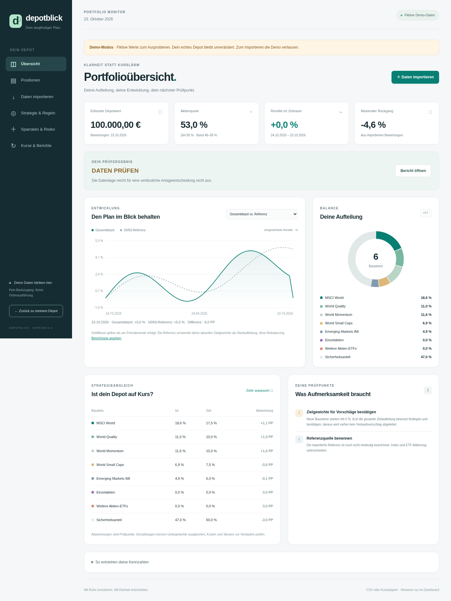
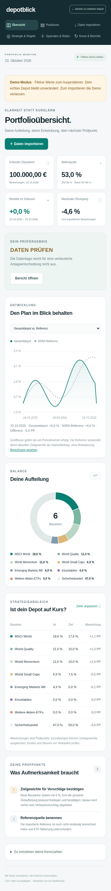
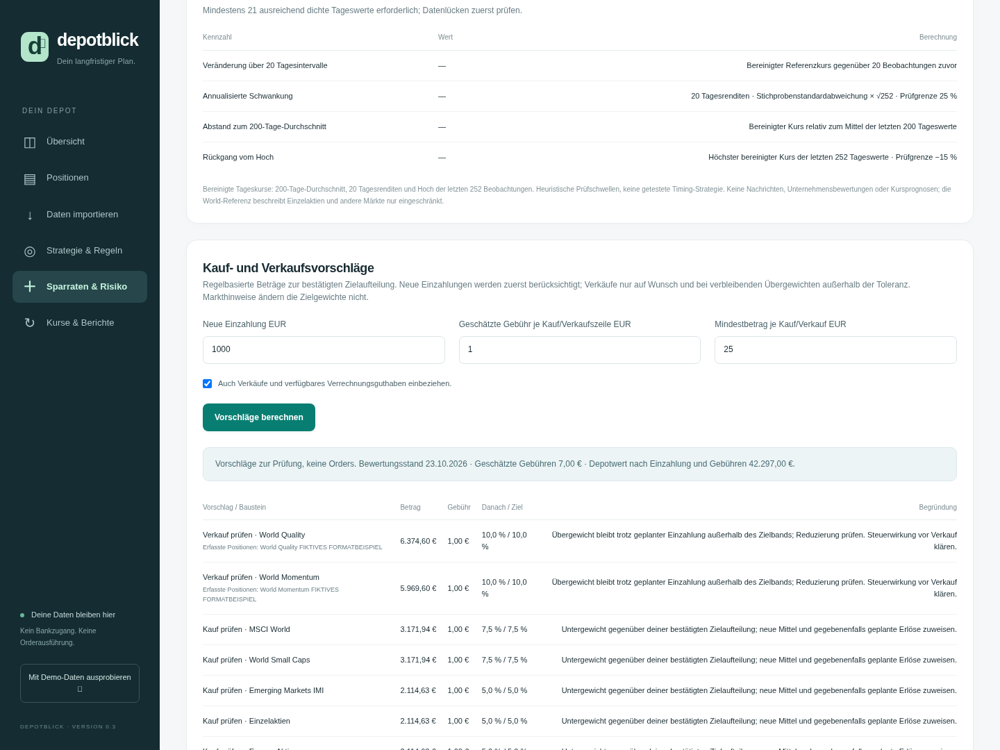

# Depotblick 0.3

Lokaler Portfoliomonitor für das besprochene ETF-Musterportfolio: ING-orientierter CSV-Import, kostenlose Tageskurse, Buchungen, nachvollziehbare Renditeberechnung, Sparratenplan, Kauf-/Verkaufsvorschläge und Marktlage-Check. Hinweise bleiben ausschließlich im Dashboard. Python ≥3.11, Standardbibliothek, keine Zugangsdaten oder externen Laufzeitpakete. Die Anwendung führt keine Orders aus.

## Vorschau

Die folgenden Screenshots zeigen ausschließlich fiktive Demodaten. Sie sind direkt im Repository gespeichert und auf GitHub sichtbar. Die Anwendung selbst ist damit noch nicht öffentlich gehostet.



<details>
<summary>Mobilansicht anzeigen</summary>



</details>

<details>
<summary>Kauf- und Verkaufsvorschläge ansehen (fiktive Testdaten)</summary>



</details>

## Starten

Aus dem Projektverzeichnis in zwei Terminals:

```bash
python -m finance.server --port 8000
```

```bash
python -m finance.monitor --daemon
```

Der Webdienst bindet an die lokale Loopback-Adresse auf Port 8000. Der zweite Prozess übernimmt die geplanten Prüfungen. Er läuft nur, solange der Rechner bzw. die Cloud-Umgebung läuft. Die Onboarding-Oberfläche bietet keine Webvorschau; für eine interaktive Nutzung die Anwendung auf einem eigenen Rechner starten. Dauerhaftes Hosting ist hier nicht eingerichtet.

Neue Datenbestände sind leer. Die Demo lädt fiktive Daten nur in die Ansicht; sie schreibt nichts ins echte Depot. Standard-Datenverzeichnis: `.data/`; beide Prozesse müssen dasselbe Verzeichnis verwenden. Abweichend jeweils `--data-dir /absoluter/pfad` angeben. Der Scheduler benötigt Unix/Linux (`fcntl`). Webdienst und Einmalberichte funktionieren unabhängig davon.

## Einstieg mit deinem ING-Depot

1. **Daten importieren:** Bestands-CSV auswählen, Spalten und Zahlenformat prüfen, unbekannte Wertpapiere zuordnen, Vorschau bestätigen. Für automatische Bewertungen werden Stückzahlen benötigt; ein reiner Gesamtwert reicht nur für die manuelle Übersicht. Die bereitgestellte ING-Spaltenstruktur mit fünf Währungsspalten wird unterstützt und mit fiktiven Daten getestet. Eine vollständige echte ING-Datei wurde noch nicht geprüft.
2. **Positionen:** Verrechnungsguthaben ergänzen. Alle Ausgangsbestände einschließlich Guthaben brauchen für die automatische Fortschreibung dasselbe Datum. Keine Beträge doppelt erfassen. Das separate Guthaben ist das Konto, aus dem die Buchungen bezahlt werden. Nicht verfügbares Tages-/Festgeld gegebenenfalls als weitere `safe`-Position importieren.
3. **Kurse & Berichte:** Yahoo auswählen, ISINs den tatsächlich passenden Kurssymbolen einschließlich Börsenplatz zuordnen, EUR-Notierung und eine bereinigte World-Referenz prüfen und bestätigen. `EUNL.DE` ist ein mögliches ETF-Referenzsymbol, keine direkte MSCI-Indexreihe. Ein Symbol wird nicht aus einem Fondsnamen erraten.
4. **Kurse abrufen & bewerten:** Erst ein vollständig passender gemeinsamer Kursstand aktualisiert das Depot. Der automatische Renditeverlauf beginnt mit dieser ersten Bewertung; mindestens zwei Bewertungstage sind für Renditen erforderlich. Die abrufbaren zwei Jahre Fondskurse sind keine rekonstruierte persönliche Depothistorie.
5. Neue Buchungen regelmäßig importieren und Bestände mit ING abgleichen. Aktuelle Kurse bestätigen keine aktuellen Stückzahlen oder Bankguthaben. Der Scheduler bewertet ausschließlich die erfassten Bestände.

Eine manuell importierte Depot-Renditehistorie und die automatische Reihe bleiben getrennt. Im Menü „Renditehistorie“ wird gewählt, welche Reihe ausgewertet wird. CSV-Vorlagen in `examples/` enthalten ausschließlich fiktive Beispiele, niemals automatisch echte Daten ersetzen.

## Modell und Prüfregeln

| Baustein | Zielanteil am Gesamtdepot |
|---|---:|
| MSCI World | 17,5 % |
| World Quality | 10 % |
| World Momentum | 10 % |
| World Small Caps | 7,5 % |
| Emerging Markets IMI | 5 % |
| Einzelaktien | 0 % (zunächst unbestätigt) |
| Weitere Aktien-ETFs | 0 % (zunächst unbestätigt) |
| Sicherheit | 50 % |

Die ursprünglichen 35/20/20/15/10 beschreiben den Aktienanteil. Gewichte sind editierbar; vorhandene Nutzereinstellungen bleiben bei Schemaerweiterungen erhalten. Das Modell ist keine Garantie für einen Mehrertrag oder eine Verlustgrenze von 20–30 %. Ein separat vorhandener Notgroschen wird vorausgesetzt.

Standardregeln:

- Aktienquote außerhalb von ±5 Prozentpunkten zum Ziel prüfen.
- Bausteinabweichung **über 5 Prozentpunkte ODER über 25 % relativ zum Ziel** prüfen. Bei Ziel 0 zählt ein positiver Bestand als Abweichung.
- Aktueller Rückgang vom Höchststand: ab 10 % beobachten, ab 15 % analysieren, ab 20 % ausführlicher Portfolio-Check. Eine zusätzliche eigene Rückgangsschwelle ist einstellbar. Kein automatischer Verkauf.
- Kursstand älter als zwei Wochentage oder Bestandsabgleich älter als sieben Wochentage: Daten prüfen. Feiertage werden nicht als besondere Börsentage modelliert.
- Entscheidung: **HALTEN**, **BEOBACHTEN**, **REBALANCING PRÜFEN**. Unvollständige, widersprüchliche oder veraltete Daten haben Vorrang: **DATEN PRÜFEN**.

`AGENTS.md` hält diese Regeln für spätere Arbeiten mit Codex fest. Neue Mittel werden bevorzugt. Der Sparratenplan berücksichtigt den neuen Gesamtdepotwert, Gebühren je ETF-Kauf und Cent-Rundung. Er erstellt weder Verkaufsorders noch Stückzahlen; Steuern und brokerspezifische Mindestgrößen sind nicht enthalten. Beispiel: EM-Bestand 1.600 EUR bei 50.000 EUR Gesamtwert benötigt für 10 % Zielgewicht rund 3.777,78 EUR neue Mittel ausschließlich in EM, nicht nur die bisherige Ziellücke von 3.400 EUR.

## Einzelaktien und eigene Bausteine

Unter **Strategie & Regeln** sind Einzelaktien (`stocks`) und weitere Aktien-ETFs (`other_equity`) direkt verfügbar. Dazu passen etwa einzelne Unternehmensaktien beziehungsweise ein All-World-, Branchen- oder Länder-Aktien-ETF. Alternativ bis zu 20 eigene Kategorien mit Namen und Anlageart anlegen, beispielsweise „Europa-Aktien“ oder „Anleihen“. Danach stehen sie in der CSV-Vorschau zur Auswahl.

- **Aktienanlage:** zählt vollständig zur Aktienquote, auch bei Einzelaktien und eigenen Aktien-ETF-Kategorien.
- **Andere Anlage:** zählt nicht zur Aktienquote, z. B. Anleihen oder Gold. Das bedeutet nicht risikolos. Mischfonds mit variablem Aktienanteil werden nicht anteilig durchgerechnet.
- Bestehende Zielgewichte bleiben erhalten. Neue Kategorien beginnen mit 0 %, und die Bestätigung der Zielaufteilung wird aufgehoben. Erst bewusst Gewichte verteilen, insgesamt 100 % herstellen und die Checkbox zur Verwendung für Vorschläge bestätigen.
- Ein verwendeter Baustein kann nicht gelöscht oder zwischen Aktien-/anderer Anlage umklassifiziert werden. Das schützt aktuelle, fortgeschriebene und archivierte Bestände. Unbenutzte eigene Kategorien mit 0 % Ziel lassen sich entfernen; die Standardkategorien bleiben erhalten.
- Für weitere Wertpapiere bleiben Kurssymbol, Börsenplatz, Referenzwährung, Stückzahl und Buchungsdaten ausdrücklich zu prüfen. Der Name allein begründet keine automatische Zuordnung.

## Kauf-/Verkaufsvorschläge und Marktlage

Unter **Sparraten & Risiko** gibt es zwei getrennte Funktionen:

**Vorschläge zur Zielaufteilung:** Neue Einzahlung, geschätzte feste Gebühr je Kauf-/Verkaufszeile und Mindestbetrag eingeben. Standardmäßig werden nur neue Mittel verteilt. Optional „Auch Verkäufe und verfügbares Verrechnungsguthaben einbeziehen“ wählen.

Der Rechner prüft zuerst, ob neue Einzahlungen Übergewichte ausreichend abbauen. Nur verbleibende Übergewichte außerhalb des Zielbands führen bei aktivierter Option zu Verkaufsbeträgen. Erlöse und neues Geld werden auf Untergewichte verteilt. Gebühren, Cent-Rundung und Mindestbeträge werden berücksichtigt; Restabweichungen bleiben sichtbar. Nur ausdrücklich als Verrechnungsguthaben erfasste Beträge können aus dem Sicherheitsanteil eingesetzt werden. Sicherheits-Wertpapiere gelten nicht automatisch als verfügbares Bargeld.

Konkrete Beträge sind bei fehlenden/veralteten/widersprüchlichen Daten oder nicht bestätigten Zielgewichten gesperrt. Insbesondere führt ein neu hinzugefügter 0-%-Baustein vor der Bestätigung nicht automatisch zu einem Verkaufsvorschlag. Die bisherige Sparratenfunktion bleibt ein ausdrücklich gekennzeichnetes Rechenbeispiel bei unvollständigen Daten.

Vorschläge gelten je Baustein. Bei mehreren Wertpapieren innerhalb einer Kategorie wird keines automatisch ausgewählt. Es gibt keine Stückzahlberechnung, Aktienauswahl, Bewertung „günstig/teuer“, Orderausführung oder Bankanbindung. Geschätzte Gebühren unterstellen eine Transaktion pro Kauf-/Verkaufszeile; tatsächliche ING-Kosten, mehrere Orders, Steuern, Spreads, Stückrundung und Verfügbarkeit nach Abwicklung sind vor Umsetzung separat zu prüfen. Der Rechner unterstellt sofort verfügbare Verkaufserlöse. Er verändert weder Bestände noch das Buchungsjournal.

**Marktlage aus Referenzkursen:** Der separate Check beschreibt abgeschlossene bereinigte Tageskurse der bestätigten World-Referenz. Angezeigt werden Quelle, Kursstand, Beobachtungszahl und:

| Kennzahl | Regel / Bedeutung |
|---|---|
| Veränderung über 20 Tagesintervalle | Letzter bereinigter Kurs relativ zu 20 Beobachtungen zuvor |
| Annualisierte Schwankung | Stichprobenstandardabweichung der letzten 20 Tagesrenditen × √252; Prüfgrenze 25 % |
| Langfristiger Trend | Abstand zum Mittel der letzten 200 Tageswerte; unter dem Mittel entsteht ein Prüfhinweis |
| Rückgang vom Hoch | Gegenüber dem höchsten bereinigten Kurs der letzten 252 Beobachtungen; Prüfgrenze −15 % |

Mindestens 21 ausreichend dichte Tageswerte sind nötig; 200 bzw. 252 Werte für die längeren Kennzahlen. Feiertagslücken bis zu sieben Kalendertagen sind möglich, eine überwiegend wöchentliche Serie wird abgelehnt. Fehlende Werte bleiben offen. Veraltete oder unbestätigte Referenzdaten führen zu keiner aktuellen Markteinschätzung. 252 Beobachtungen sind eine Handelstage-Näherung, keine exakte Kalenderjahresabgrenzung.

Die Schwellen sind **Heuristiken, keine getestete Timing-Strategie**. Hinweise regen eine Prüfung von Risikobudget und gegebenenfalls Kauftranchen an, verändern aber weder Zielgewichte noch berechnete Handelsbeträge. Ein fallender Referenzmarkt löst allein keinen Verkauf aus. Der World-ETF beschreibt einzelne Unternehmen, Branchen und andere Länder nur eingeschränkt; Nachrichten, Zinsen, Fundamentaldaten und Kursprognosen sind nicht angebunden. Das Fehlen eines Risikohinweises ist keine Kaufempfehlung. Der Marktcheck erscheint auch in Tages-/Wochenberichten.

## Lokal aktualisieren

Server und gegebenenfalls Scheduler beenden. Bei einem Git-Checkout `git pull --ff-only` ausführen; bei ZIP-Nutzung die neue Version entpacken und die Programmdateien aktualisieren. Den privaten Ordner `.data` zuvor sichern und beibehalten, nicht durch Beispieldaten ersetzen. Danach Prozesse neu starten und den Browser neu laden. Die vorhandene Datenbank wird um neue Konfigurationsfelder ergänzt; Bestände, Buchungen und bisherige Zielgewichte bleiben erhalten. Zielgewichte vor Nutzung konkreter Vorschläge ausdrücklich bestätigen.

## Bestands-CSV

```csv
name,isin,bucket,quantity,price,cost_basis,currency,as_of
Quality,IE00BP3QZ601,quality,10,100,900,EUR,2026-10-22
```

Spaltenzuordnung unterstützt auch ING-ähnliche Überschriften, Semikolon, Dezimalkomma, Tausenderpunkte, UTF-8/Windows-1252 und `sep=;`. Metadaten- und Summenzeilen vorher entfernen. `examples/ing-style.csv` ist kein bestätigter Originalexport.

Für die ING-Kopfzeile mit `ISIN;Wertpapiername;Stück/Nominale;Einheitskennzeichen;Einstandskurs;Währung;Einstandswert;Währung;Bewertungskurs;Währung;Zeit;Handelsplatz;Kurswert;Währung;Gewinn/Verlust;Währung;Gewinn/Verlust (%)` gilt diese automatische Zuordnung:

| Zielfeld | ING-Spalte |
|---|---|
| Bezeichnung | Wertpapiername |
| ISIN | ISIN |
| Stückzahl | Stück/Nominale |
| Kurs | Bewertungskurs |
| Gesamtwert | Kurswert |
| Währung des Werts | Währung direkt nach Kurswert |
| Einstandswert | Einstandswert, nicht Einstandskurs |
| Bewertungsdatum | Manuell angeben; Zeit bleibt unzugeordnet |

Die fünf gleichnamigen Währungsspalten erhalten intern eindeutige Namen wie `Währung (Kurswert)`. Die Originaldatei muss dafür nicht umbenannt werden. Diese Ausnahme gilt nur für die erkannte vollständige ING-Spaltenfolge; andere doppelte Überschriften bleiben ein Fehler. Eine vollständig quotierte Kopfzeile wird ebenfalls unterstützt.

`Einheitskennzeichen` muss bei einer übernommenen Stückzahl eine unterstützte Stückeinheit enthalten (z. B. STK oder Stück). Nominalpositionen können wertbasiert ohne Stückzahl importiert werden; sie sind damit nicht für eine automatische Stückzahlbewertung geeignet. Kurswert und übernommener Einstandswert müssen jeweils in Referenzwährung vorliegen. Ein abweichender Bewertungskurs in Fremdwährung wird nicht für die Berechnung verwendet, wenn der Kurswert bereits in Referenzwährung angegeben ist. Leere Einstandswerte bleiben unbekannt; bei einer abweichenden Einstandswährung die optionale Zuordnung entfernen oder zuvor nachvollziehbar umrechnen. Die Gewinn/Verlust-Spalten sind keine Renditehistorie.

`examples/ing-holdings.csv` verwendet diese Kopfzeile mit ausschließlich fiktiven Positionen, Zahlen, Einheiten und Uhrzeiten. Das tatsächliche Format der Datenzeilen muss in der Vorschau geprüft werden. Bei `Zeit` darf eine Uhrzeit nicht als Kalenderdatum interpretiert werden; das Datum des Bestandsstands ausdrücklich angeben und veraltete Kursstände gesondert prüfen.

- Alternativ `value` statt Stückzahl × Kurs. Ein zugeordneter Gesamtwert hat Vorrang; bei vorhandener Stückzahl wird der passende Preis daraus abgeleitet.
- `cost_basis` ist optional: gesamter Einstandswert der Position, nicht Stückpreis. Daraus entstehen Buchgewinne; nach Verkäufen wird der Einstandswert nach Durchschnittskosten reduziert. Keine steuerliche FIFO-Berechnung und keine Gesamtrendite seit Kauf inklusive realisierter Gewinne/Ausschüttungen.
- `bucket`: `world`, `quality`, `momentum`, `small`, `em`, `stocks`, `other_equity`, `safe` oder die ID eines angelegten eigenen Bausteins. Bekannte ISINs werden vorgeschlagen; unbekannte Anlagen erfordern Zuordnung. Keine Live-Verifikation von Fondskosten/Stammdaten.
- Alle Werte in Referenzwährung; keine automatische Devisenumrechnung. Keine Shortpositionen, Kredite, Hebelprodukte oder Anleihenbewertung aus Prozentkursen.
- Identität ist die ISIN; ohne ISIN eine aus Name und Baustein abgeleitete ID. Doppelte Positionen derselben ISIN vor dem Import zusammenfassen. IDs stehen in der Kurszuordnung.
- Ein Import ersetzt den Ausgangsbestand der CSV-Positionen, erhält aber das separate Guthaben. Änderungen an Ausgangsbestand oder Kurszuordnung erfordern bei bestehender automatischer Historie einen neuen Bewertungszeitraum. Die bisherige Reihe wird unter „Neuen Bewertungszeitraum starten“ archiviert und bleibt im JSON-Export erhalten.

## Transaktionen

```csv
id,date,type,instrument_id,quantity,price,amount,fee,currency
einzahlung-1,2026-10-23,DEPOSIT,,0,0,1000,0,EUR
kauf-1,2026-10-23,BUY,IE00BP3QZ601,5,100,500,1,EUR
```

Exakte Spalten, Dezimalpunkte, ISO-Datum, Referenzwährung. Unterstützt: `BUY`, `SELL`, `DEPOSIT`, `WITHDRAWAL`, `DIVIDEND`, `INTEREST`, `FEE`, `TAX`, `SPLIT`. Die Datei ergänzt das Buchungsjournal; sie ersetzt es nicht.

| Typ | Eingabe / Wirkung |
|---|---|
| BUY / SELL | Positive Stückzahl und Preis; `amount = quantity × price`, Gebühr separat. Kauf belastet, Verkauf erhöht das Verrechnungsguthaben. |
| DEPOSIT / WITHDRAWAL | Positiver Betrag, keine Positions-ID; externer Geldfluss. |
| DIVIDEND | Bekannte Positions-ID, positiver Bruttobetrag; `fee` kann eine separat zu berücksichtigende Abzugssumme enthalten. Keine automatische Erfassung. |
| INTEREST | Positiver Betrag, keine Positions-ID, optionaler Abzug in `fee`. |
| FEE / TAX | Positiver Betrag, keine Positions-ID; separate Belastung des Verrechnungskontos. |
| SPLIT | Bekannte Positions-ID; `quantity` ist der Splitfaktor (z. B. 2), Preis/Betrag/Gebühr sind 0. |

Identische Buchungs-ID mit identischem Inhalt wird übersprungen; widersprüchlicher Inhalt wird abgelehnt. Buchungen am Ausgangsdatum und davor gelten als bereits im Ausgangsbestand enthalten. Am selben Tag gilt die importierte Reihenfolge; Einzahlungen vor finanzierungsabhängigen Käufen aufführen. Fehlendes Guthaben und Überverkäufe werden abgelehnt. Neue Anlagen vorher mit Stückzahl 0 im Ausgangsbestand registrieren; bei laufender Historie ist das ein neuer Bewertungszeitraum.

Ein Buchungsimport aktualisiert zunächst das Journal. Erst eine gemeinsame Kursbewertung aktualisiert Werte und Renditen. Buchungen zu einem früheren bereits verketteten Bewertungstag blockieren die weitere Renditeverkettung; den Zeitraum archivieren oder die jüngste Tagesbewertung mit korrigierten Daten erneut berechnen. Am selben Tag ersetzt eine Wiederholung die letzte automatische Bewertung ohne doppelte Geldflüsse. Ausschüttungen, Zinsen und Steuern müssen vollständig erfasst werden; hierfür besteht keine Bankanbindung.

## Kostenlose Tageskurse und CSV-Alternative

Yahoo Finance wird über HTTPS `query1.finance.yahoo.com` abgefragt, maximal zwei Jahre Tagesdaten. Es ist eine öffentliche, inoffizielle Quelle ohne Verfügbarkeitsgarantie. An den Anbieter gehen die konfigurierten Symbole, keine Depotbeträge, Kontodaten oder Buchungen. Kein API-Schlüssel. Die Cloud-Netzwerkfreigabe umfasst diese Domain; TLS-Prüfung bleibt aktiv.

Noch laufende Tageskerzen werden nicht verwendet; heutige Werte frühestens 15 Minuten nach gemeldetem regulärem Börsenschluss. Ein Abruf ist deshalb kein Echtzeit-Alarm. Für die Bewertung wird der jüngste gemeinsame Handelstag aller benötigten Positionen und der Referenz verwendet. Es gibt keine stillen Währungsumrechnungen oder Mischung unterschiedlich datierter Positionskurse. Fällt eine Quelle aus, bleiben die vorherige Bewertung und Historie erhalten; der Fehler wird sichtbar. Es gibt höchstens einen automatischen Wiederholungsversuch je HTTP-5xx-Fehler.

Kursdatei als Alternative:

```csv
symbol,date,close,adjusted_close,currency,source
QUALITY.EXAMPLE,2026-10-22,100,100,EUR,Fiktives Formatbeispiel
WORLD.EXAMPLE,2026-10-22,100,100,EUR,Fiktives Formatbeispiel
```

Optional `split_ratio` (Standard 1). `close` bewertet Positionen, `adjusted_close` dient dem Fonds-/Referenzrenditevergleich. Die Referenz benötigt bereinigte Kurse. Quellenkorrekturen ersetzen gleiche Symbol-/Datumspaare im Kursarchiv. Der Import schreibt zunächst nur Kurse; „Gespeicherte Kurse bewerten“ startet die Bewertung. Sicherheitspositionen ohne Symbol werden als Nutzerwerte fortgeschrieben. Erkannte Splits seit dem Ausgangsdatum brauchen eine passende SPLIT-Buchung; andere Kapitalmaßnahmen müssen manuell geprüft werden.

## Rendite, Risiko und Grenzen

Der automatische Verlauf beginnt mit der ersten erfolgreichen Bewertung. Heutige Stückzahlen werden niemals für frühere persönliche Depotwerte verwendet. Historische bereinigte Fondskurse erlauben einen separaten Fondsvergleich, keine persönliche Rendite und keine statistische Faktorattribution.

Die separat importierbare Renditehistorie erwartet:

```csv
date,total_value,equity_value,net_flow,equity_flow,world_index,safety_index
2026-09-30,100000,50000,0,0,100,100
2026-10-22,103000,52500,1000,1000,102,100.2
```

`total_value` umfasst den Sicherheitsanteil; `equity_value` nur Aktien. `net_flow` ist der externe Nettozufluss seit der vorigen Bewertung; `equity_flow` der Nettozufluss in den Aktienanteil einschließlich Umbuchungen aus dem Sicherheitsanteil. Die erste Beobachtung hat beide Flüsse 0. Interne Käufe sind kein externer Zufluss. Ausschüttungen an das erfasste Verrechnungskonto bleiben innerhalb des Gesamtdepots, verlassen aber den Aktienanteil. Kauf-/Verkaufsgebühren werden wirtschaftlich berücksichtigt; separate Steuern/Gebühren belasten das Gesamtdepot. Steuerliche Ergebnisse werden nicht simuliert.

Intervallrendite: `(Endwert − Geldfluss) / vorheriger Endwert − 1`, anschließend geometrische Verkettung. **Alle Geldflüsse gelten als am Intervallende erfolgt.** Bei tatsächlichen Zwischenzuflüssen sind zusätzliche Bewertungen nötig; sonst ist dies eine Näherung an die zeitgewichtete Rendite. Gilt besonders für mehrtägige Lücken. Einzahlungen werden nicht einfach als Gewinn gerechnet.

Die World-Referenz muss eine konsistente Total-Return-Reihe in Referenzwährung sein. Ein bereinigter ETF ist eine Näherung mit eigenen Kosten. Die gemischte Referenz startet mit den aktuellen Zielgewichten und wird danach ohne Rebalancing gehalten. Zieländerungen ändern diese Vergleichslinie rückwirkend. Die automatische Referenz für sämtliche Nicht-Aktien-Bausteine ist **unverzinst**, auch wenn dort beispielsweise Anleihen oder Gold eingeordnet sind; sie bildet deren Marktrisiken nicht nach; eine importierte `safety_index`-Reihe kann eine andere ausdrücklich benannte Sicherheitsreferenz abbilden. Quellen können nicht fachlich authentifiziert werden.

Kennzahlen:

- Letztes Tagesintervall, letzte sieben Tage, laufender Monat, seit Jahresbeginn, seit Historienbeginn. Ohne geeigneten Ausgangswert wird keine Teilperiode als volle Periode ausgegeben.
- Aktueller/maximaler Drawdown auf der geldflussbereinigten Reihe; nur vorhandene Beobachtungen zählen. Wochen-/Monatsdaten können zwischenzeitliche Verluste übersehen.
- Annualisierte Volatilität erst ab 20 ausreichend dichten Tagesintervallen, Stichprobenstandardabweichung × √252. Keine Annualisierung von Monatswerten als Tageswerte.
- Buchgewinn bei vorhandenem Einstandswert und Fondsvergleich auf gemeinsamen bereinigten Kursdaten.

Noch nicht enthalten: vollständige persönliche Gesamtrendite seit Kauf/XIRR, Durchschau auf einzelne Unternehmen/Länder/Sektoren, automatische Nachrichten-/Makroanalyse, automatische Fondsstammdaten- und Gebührenüberwachung, echtes ING-Buchungsformat oder Broker-Synchronisierung. Der Monitor kann weder Outperformance garantieren noch Verluste begrenzen.

## Hinweise, Ereignisse und Zeitplan

Alle Hinweise bleiben lokal. Ein Prüflauf protokolliert neue Hinweise; gleiche Hinweise werden nicht jedes Mal erneut angelegt. Neue Eskalationsstufen oder Wiederauftreten nach Auflösung erzeugen einen neuen Eintrag. Das Dashboard zeigt die jüngsten 20, gespeichert werden bis zu 100.

Manuell belegte Fondsereignisse lassen sich importieren:

```csv
id,date,instrument_id,type,title,url,status
hinweis-1,2026-10-22,,market,Fiktives Beispiel,https://example.com,resolved
```

Typen: `fund_closure`, `index_change`, `tracking_difference`, `aum_change`, `market`. `open` führt zu einem Prüfhinweis, `resolved` schließt denselben Hinweis. HTTPS-Quelle erforderlich; kein automatischer Abruf oder Wahrheitsnachweis. Tages-/Wochenberichte formulieren nur berechnete Fakten und erfasste Hinweise, keine erfundenen Marktursachen oder Konfidenzwerte.

Der laufende Scheduler verwendet **Europe/Berlin** einschließlich Sommerzeit:

- Mo–Fr 22:15: Kurse holen (wenn Yahoo eingerichtet), gemeinsam bewerten, Tagescheck und Dashboard-Hinweise aktualisieren.
- Sonntag 18:00: Wochenbericht aus dem gespeicherten Stand erstellen.
- Vor geplanten Läufen eine SQLite-Sicherung pro Datum. Abgeschlossene Läufe werden nicht nach jedem Neustart wiederholt. Frühere verpasste Tage werden nicht rückwirkend mit heutigen Beständen befüllt.
- Technische Fehler werden vermerkt; kein endloser Wiederholungsversuch am selben Tag. Ein manueller Prüflauf bleibt möglich.

Einmalige Läufe:

```bash
python -m finance.monitor --update
python -m finance.monitor --mode weekly
python -m finance.report --output .data/latest-report.json --check
```

`monitor --update` aktualisiert Kurse und Werte; ohne `--update` prüft es vorhandene Daten. Berichte unter `.data/reports/latest-daily.{json,md}` bzw. `latest-weekly.{json,md}`. `finance.report` bleibt als reiner JSON-Prüfbericht kompatibel. Exit 0: keine Hinweise; 2: Daten-/Strategiehinweise; 1: Aktualisierungs-/technischer Fehler. Bei leerem Depot ist „DATEN PRÜFEN“ erwartbar und keine abgeschlossene Portfolioüberwachung.

Der Scheduler hat eine Sperre gegen Doppelstarts und einen Heartbeat; das Dashboard zeigt aktiv/inaktiv. Ein grüner Prozessstatus sagt nichts über erfolgreiche Kursversorgung aus. Eine Cloud-Entwicklungsumgebung ist kein zugesicherter 24/7-Betrieb. Nach Wiederherstellung beide Prozesse neu starten. Für einen dauerhaft verfügbaren Linux-Rechner ist `deploy/depotblick-monitor.service.example` als anzupassende, nicht installierte Vorlage beigefügt.

## Daten, Sicherung und Entwicklung

Private Daten liegen in `.data/portfolio.sqlite3`, ignoriert von Git. Änderungen sind transaktional und mit einer Versionsnummer vor Überschreiben durch alte Browseransichten geschützt. Ungültige Importe werden abgelehnt. Schema 2 ergänzt bestehende Daten; Nutzerwerte werden nicht durch Defaults ersetzt. Der JSON-Export enthält Journal, Kurse, Konfiguration und archivierte automatische Historien. Ein JSON-Wiederimport ist nicht implementiert.

Sicherung während des Betriebs mit SQLite-Backup:

```bash
python - <<'PY'
from finance.storage import Store
Store('.data').backup('.data/backups/manuelle-sicherung.sqlite3')
PY
```

Die Sicherungsdatei darf noch nicht existieren. Zur Wiederherstellung beide Prozesse stoppen und eine private Sicherung als `.data/portfolio.sqlite3` zurückkopieren. Dateirechte 0600, Datenverzeichnis 0700 für neu erzeugte Verzeichnisse; keine Datenträgerverschlüsselung. Sicherungen haben aktuell keine automatische Löschfrist und sollten privat nach einer passenden Aufbewahrungsregel verwaltet werden. Keine Depotdateien, `.data`, `.runtime` oder Geheimnisse in Git aufnehmen. Der lokale Dienst hat keine Benutzeranmeldung; nicht unverändert öffentlich betreiben.

```bash
python -m unittest discover -s tests -v
node --check static/app.js
node --check static/expansion.js
node --check static/decisions.js
python scripts/browser_smoke.py
```

92 Unit-/HTTP-Tests sowie Browserabläufe wurden geprüft, einschließlich ING-Spalten mit mehrfacher Währung und ausdrücklich angegebenem Bewertungsdatum; der optionale Browsercheck benötigt Playwright und Chromium, verwendet eine isolierte Datenbank und synthetische Daten. Node/Playwright sind keine Laufzeitabhängigkeiten. Der Live-Abruf und der neue Marktlage-Check für EUNL.DE wurden am 23.10.2026 erfolgreich geprüft (252 jüngste Tageswerte für den Marktcheck, EUR, Kursstand 23.10.2026); das bestätigt weder die Zuordnung anderer Fonds noch die zukünftige Verfügbarkeit.

Den vorhandenen Checkout verwenden, keine zusätzlichen Git-Worktrees. Das Projekt-Repository ist `chrisko1989/finance`, Hauptbranch `main`. Private Depotdaten und Laufzeitdateien gehören nicht ins Repository. Cloud-Startanweisungen sichern Start, Datenverzeichnis und Funktionsprüfung. Keine Beispieldaten beim Start ins echte Depot übernehmen.
